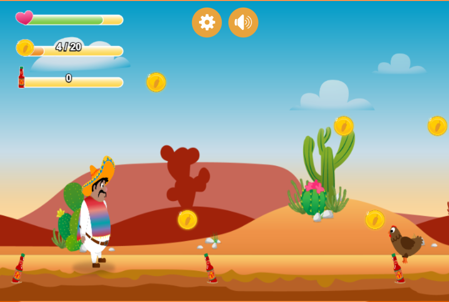

<div align="center">

# 🐔 El Pollo Loco

**A 2D jump-and-run in the browser** — Pepe runs through the desert, collects coins and bottles, defeats chickens, and finally faces an end boss.

**🎮 [Play live](https://pollo.manuel-von-kneten.de/)**



</div>

The game runs entirely in the browser on an HTML `<canvas>` element and is written in plain, object-oriented vanilla JavaScript — no frameworks or build tools.

---

## ✨ Features

- 🏃 Walk, jump, and throw controls for the player character (keyboard and touch)
- 😴 Idle and sleep animation when Pepe hasn't moved for a while
- 🐓 Regular and small chickens, defeated by jumping on top or by a bottle throw
- 👹 End boss with its own health bar, alert/attack animations, and patrol behavior
- 🪙 Collectible coins and bottles with their own status bars in the HUD
- 🏁 Start, game-over, and win screens with a restart function
- ⚙️ Settings menu with an imprint
- 🔊 Music and sound effects with mute toggle (`M` key or button), state persisted via `localStorage`
- 📱 Mobile touch controls including a prompt to rotate the device to landscape, responsive menu with no scrollbars even on small displays
- 🖥️ Fullscreen mode: real fullscreen via click on desktop/Android; on iPhone (Safari/Chrome) only available by installing as a PWA ("Add to Home Screen") — see the Tech section

## 🎮 Controls

| Key               | Action                             |
|-------------------|-------------------------------------|
| `←` / `→`         | Walk                               |
| `↑` / Space       | Jump                                |
| `D`               | Throw bottle                       |
| `M`               | Toggle music/sound                 |

On mobile devices, touch buttons are available at the bottom of the screen instead.

## 🚀 Running the project locally

Since the game loads images and sounds via relative paths, it should be opened through a local server (not by double-clicking `index.html`):

```bash
# in the project folder
python -m http.server 8000
```

Then open `http://localhost:8000` in your browser.

## 📁 Project structure

```
El_Pollo_Loco/
├── index.html                       Entry point, canvas and UI overlays
├── style.css                        Layout, overlays, theme
├── manifest.json                    Web app manifest (PWA, fullscreen on iOS)
├── robots.txt                       Crawler access
├── .htaccess                        Forces HTTPS, sets HSTS header
├── audio/                           Music & sound effects (.mp3)
├── fonts/                           Zabars.ttf, Roboto (self-hosted, no Google Fonts CDN)
├── img/                             Sprites, backgrounds, icons, status bars
├── js/
│   ├── game.js                      Game state (start/game over/win/restart), keyboard, touch & fullscreen
│   ├── sounds.js                    Sound and music playback
│   └── levels/
│       └── level1.js                Layout of the first level
└── models/
    ├── drawable-objects.class.js    Base class: drawing & animation
    ├── movable-object.class.js      Base class: movement, gravity, collision
    ├── character.class.js           Player character (Pepe)
    ├── chicken.class.js             Regular enemies
    ├── chicken-small.class.js       Small enemies
    ├── endboss.class.js             End boss
    ├── throwable-objects.class.js   Thrown bottles
    ├── coin.class.js                Collectible: coin
    ├── bottle.class.js              Collectible: bottle
    ├── status-bar.class.js          HUD status bars (health/coins/bottles/end boss)
    ├── cloud.class.js               Clouds
    ├── background-object.class.js   Background layer
    ├── level.class.js               Level data
    ├── keyboard.class.js            Keyboard state
    └── world.class.js               Central game logic (collisions, drawing, loop)
```

## 🛠️ Tech

- Plain vanilla JavaScript (ES6 classes), no framework
- Rendering via the HTML5 Canvas API
- No build steps or dependencies required
- All fonts (Zabars, Roboto) are served locally, no external requests to Google Fonts
- Installable as a Progressive Web App (`manifest.json`) — on iOS, "Add to Home Screen" is the only way to get real fullscreen, since Safari/Chrome on iOS (both WebKit) don't support the Fullscreen API for regular page elements
- `.htaccess` forces HTTPS (301 redirect) and sets an HSTS header (requires Apache hosting)

---

<div align="center">

This project was created as part of a course project and serves learning purposes.

</div>
